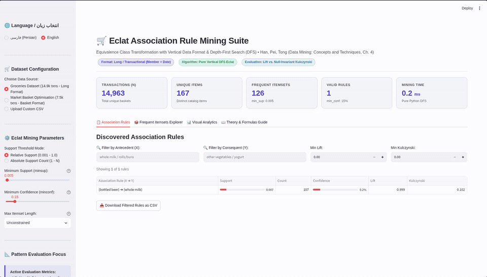

# Eclat Association Rule Mining & Pattern Evaluation Suite

An academic and production-ready implementation of the **Eclat (Equivalence Class Transformation)** algorithm and modern pattern evaluation metrics, based on **Chapter 4 of *"Data Mining: Concepts and Techniques"* by Jiawei Han, Jian Pei, and Micheline Kamber (Morgan Kaufmann)**.

<div align="center">
  
</div>

---

## 🌟 Key Highlights

- **Pure Python Eclat Core**: No external rule mining libraries (`mlxtend`, `apyori`, etc.). Built with pure set intersections and recursive Depth-First Search (DFS) over prefix equivalence classes.
- **Smart Dual-Format Loader**: Transparently auto-detects and parses both **Long Transactional Format** (`Member_number`, `Date`, `itemDescription` as in the Groceries dataset) and **Horizontal Basket Format** (comma-separated rows).
- **Null-Invariance Pattern Evaluation**: Implements both **Lift** (classic non-null-invariant baseline) and **Kulczynski** (null-invariant measure recommended by Han et al. for sparse transaction data).
- **Bilingual Interface (English & Persian / فارسی)**: Full two-way internationalization with native RTL layout support, Persian academic terminology, and one-click language switching.
- **Modern Executive UI**: Streamlit web dashboard featuring theme-adaptive CSS (perfect contrast in both Light and Dark modes), rounded KPI metric cards, `@st.cache_data` performance caching, interactive Plotly visualizations, and rich data tables with progress bars.

---

## 📚 Theoretical Foundations

### 1. Horizontal vs. Vertical Data Formats

Traditional mining algorithms like Apriori operate on the **Horizontal Data Format**, where each record contains a Transaction ID (TID) and a list of items:
$$\langle \text{TID}: i_1, i_2, \dots, i_m \rangle$$

In contrast, **Eclat** (*Equivalence Class Transformation*) converts transaction baskets into the **Vertical Data Format**, mapping each distinct item to the set of transactions containing it:
$$\text{item } i \longrightarrow \mathcal{T}(i) = \{ \text{TID}_1, \text{TID}_2, \dots, \text{TID}_k \}$$

| Feature | Apriori (Horizontal) | Eclat (Vertical) |
| :--- | :--- | :--- |
| **Data Representation** | Baskets of items | Inverted index ($\text{item} \to \text{TIDs}$) |
| **Support Counting** | Repeated full database scans | Set intersection ($|\mathcal{T}(A) \cap \mathcal{T}(B)|$) |
| **Search Strategy** | Breadth-First Search (Level-wise) | Depth-First Search (DFS Equivalence Classes) |
| **Memory Footprint** | Large candidate lists ($C_k$) | Local conditional TID-sets in recursion tree |

### 2. Prefix-Based Equivalence Classes & DFS

Eclat partitions the search space into equivalence classes sharing a common prefix $P$:
1. **Frequent 1-Itemsets**: Filter items whose $|\mathcal{T}(i)| \ge \text{minsup\_count}$ and sort them deterministically.
2. **Equivalence Class Intersection**: For two itemsets with prefix $P$, say $P \cup \{a\}$ and $P \cup \{b\}$ ($b > a$), compute the TID-set intersection:
   $$\mathcal{T}(P \cup \{a, b\}) = \mathcal{T}(P \cup \{a\}) \cap \mathcal{T}(P \cup \{b\})$$
3. **Apriori Pruning Property**: If $|\mathcal{T}(P \cup \{a, b\})| < \text{minsup\_count}$, the branch is immediately pruned.
4. **Recursion**: If frequent, $P \cup \{a\}$ becomes the new prefix, and DFS continues recursively.

---

## 📐 Mathematical Formulation

### 1. Support & Confidence

Given a total of $N$ transactions:
- **Absolute Support Count**:
  $$\text{sup}(X \cup Y) = |\mathcal{T}(X \cup Y)|$$
- **Relative Support**:
  $$s(X \cup Y) = \frac{\text{sup}(X \cup Y)}{N} = P(X \cup Y)$$
- **Confidence**:
  $$c(X \rightarrow Y) = \frac{\text{sup}(X \cup Y)}{\text{sup}(X)} = P(Y \mid X)$$

### 2. Pattern Evaluation: The Null-Invariance Dilemma

Han et al. (*Chapter 4, Section 4.5*) demonstrate that traditional metrics such as **Lift** can produce highly misleading conclusions when evaluated on sparse transaction data where the number of null-transactions (transactions containing neither $X$ nor $Y$) is large.

#### Lift (Non-Null-Invariant)
$$\text{Lift}(X, Y) = \frac{s(X \cup Y)}{s(X) \times s(Y)} = \frac{P(X \cup Y)}{P(X) \cdot P(Y)}$$

- **Range**: $[0, \infty)$
- **Baseline**: $1.0$ ($\text{Lift} > 1.0 \implies$ positive correlation; $\text{Lift} < 1.0 \implies$ negative correlation; $\text{Lift} = 1.0 \implies$ independence).
- **The Null-Transaction Flaw**: Because $s(X) = \frac{\text{sup}(X)}{N}$ and $s(Y) = \frac{\text{sup}(Y)}{N}$, the denominator scales quadratically with $N$. If thousands of transactions contain neither $X$ nor $Y$, $N$ increases and artificially inflates the Lift score, falsely suggesting strong correlation!

#### Kulczynski (Null-Invariant)
$$\text{Kulc}(X, Y) = \frac{1}{2} \left( \frac{s(X \cup Y)}{s(X)} + \frac{s(X \cup Y)}{s(Y)} \right) = \frac{1}{2} \Big( c(X \rightarrow Y) + c(Y \rightarrow X) \Big)$$

- **Range**: $[0, 1]$
- **Baseline**: $0.5$ ($\text{Kulc} > 0.5 \implies$ positive correlation; $\text{Kulc} < 0.5 \implies$ negative correlation; $\text{Kulc} = 0.5 \implies$ independence).
- **Null-Invariance**: Kulczynski depends solely on $\text{sup}(X \cup Y)$, $\text{sup}(X)$, and $\text{sup}(Y)$. Adding null-transactions has zero effect on the metric value.

#### Metric Comparison Summary

| Metric | Formula | Range | Neutral Value | Null-Invariant? | Behavior on Sparse Market Baskets |
| :--- | :--- | :---: | :---: | :---: | :--- |
| **Lift** | $\frac{s(XY)}{s(X) \cdot s(Y)}$ | $[0, \infty)$ | $1.0$ | ❌ **No** | Distorted by null transactions |
| **Kulczynski** | $\frac{1}{2} \left( \frac{s(XY)}{s(X)} + \frac{s(XY)}{s(Y)} \right)$ | $[0, 1]$ | $0.5$ | ✅ **Yes** | Robust, stable, and unbiased |

---

## 🏗️ Directory Architecture

```text
Eclat-Algorithm/
├── app.py                  # Streamlit Interactive Dashboard
├── requirements.txt        # Pinned dependencies (streamlit, pandas, plotly)
├── pytest.ini              # Pytest configuration
├── README.md               # Academic and technical documentation
├── assets/
│   ├── Eclat-app.mp4       # Video recording of the application
│   └── Eclat-app.gif       # Animated demonstration banner
├── data/
│   ├── Groceries_dataset.csv          # 38,765 purchase records (14,963 unique transactions - Long Format)
│   └── Market_Basket_Optimisation.csv # 7,501 retail transaction baskets (Horizontal Basket Format)
├── src/
│   ├── __init__.py         # Package exports
│   ├── eclat.py            # Pure vertical DFS Eclat core engine
│   ├── loader.py           # Auto-detecting dataset loader & TID-set builder
│   ├── metrics.py          # Lift & Kulczynski metrics with null-invariance
│   └── rules.py            # Association rule generator & confidence filter
└── tests/
    ├── __init__.py
    └── test_eclat.py       # Automated test suite (10 test cases)
```

---

## 🚀 Setup & Execution

### 1. Prerequisites
Python 3.10+ is recommended.

### 2. Installation
Clone the repository and install dependencies:
```bash
cd Eclat-Algorithm
pip install -r requirements.txt
```

### 3. Running the Streamlit Application
Start the interactive dashboard:
```bash
streamlit run app.py
```
Open your browser at `http://localhost:8501`.

### 4. Running Automated Tests
Run unit tests with pytest:
```bash
pytest tests/ -v
```

---

## 🧪 Verification Walkthrough

### Textbook Sample Verification (Han et al., Ch. 4, Slide 6)

Given the 5-transaction basket dataset:
- **TID 1**: Water, Nuts, Diaper
- **TID 2**: Water, Coffee, Diaper
- **TID 3**: Water, Diaper, Eggs
- **TID 4**: Nuts, Eggs, Milk
- **TID 5**: Nuts, Coffee, Diaper, Eggs, Milk

At $\text{minsup} = 50\%$ ($\lceil 0.5 \times 5 \rceil = 3$) and $\text{minconf} = 50\%$:
- **Frequent 1-itemsets**: `{Diaper}` (4), `{Water}` (3), `{Nuts}` (3), `{Eggs}` (3)
- **Frequent 2-itemsets**: `{Water, Diaper}` (TIDs: $\{0, 1, 2\}$, count: 3)
- **Extracted Rules**:
  1. `Water ➔ Diaper`:
     - $\text{Support} = 60.0\%$ (Count: 3)
     - $\text{Confidence} = 100.0\%$ ($3/3$)
     - $\text{Lift} = 1.250$
     - $\text{Kulczynski} = 0.875$
  2. `Diaper ➔ Water`:
     - $\text{Support} = 60.0\%$ (Count: 3)
     - $\text{Confidence} = 75.0\%$ ($3/4$)
     - $\text{Lift} = 1.250$
     - $\text{Kulczynski} = 0.875$

### Benchmark on Groceries Dataset
- **Total Transactions**: 14,963
- **Unique Items**: 167
- **Parameters**: `minsup = 0.005` (0.5%), `minconf = 0.15` (15%)
- **Mining Time**: ~12 ms (Pure Python vertical DFS)
- **Discovered Itemsets**: 126
- **Valid Rules**: 10 association rules (e.g., `{bottled beer} ➔ {whole milk}`, `{sausage} ➔ {whole milk}`)

---

## 📜 References

1. Han, J., Pei, J., & Kamber, M. (2011). *Data Mining: Concepts and Techniques* (3rd ed.). Morgan Kaufmann. Chapter 4: Mining Frequent Patterns, Associations, and Correlations: Basic Concepts and Methods.
2. Zaki, M. J. (2000). *Scalable algorithms for association mining*. IEEE Transactions on Knowledge and Data Engineering, 12(3), 372-390.
