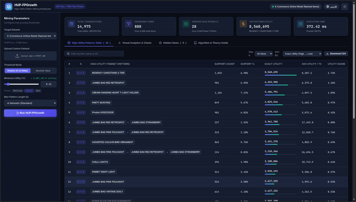
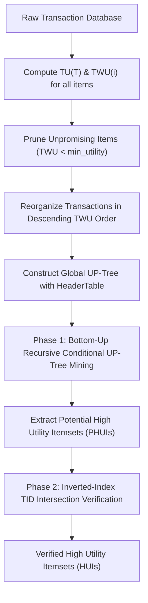

# HUP-FPGrowth • High Utility Pattern Mining
*(کاوش الگوهای با مطلوبیت بالا - دوزبانه: فارسی و انگلیسی)*

An academic and production-grade implementation of **High Utility Itemset Mining (HUIM)** using an extension of the **FP-Growth** algorithm (**UP-Growth / IHUP-TWU two-phase tree-based mining**), based on *Chapter 4 of "Data Mining: Concepts and Techniques" (Han, Pei, Tong)* and SPMF international standards.

Built with a high-performance **FastAPI** backend and an executive-grade **HTML5 + CSS3 + Vanilla JavaScript** single-page analytics dashboard featuring **full bilingual Persian (فارسی) & English** language support with instantaneous LTR/RTL switching.

<p align="center">
  
</p>

---

## 1. Problem Statement & Mathematical Foundations

In classical Frequent Itemset Mining (e.g., standard FP-Growth or Apriori), every item in a transaction is treated as a binary presence/absence indicator ($1$ or $0$), and all items are assumed to have equal business importance. In commercial reality:
1. **Items have varying quantities** per transaction (e.g., 5 bottles of wine vs. 1 carton of milk).
2. **Items have different profit margins or utility weights** (e.g., high-margin luxury electronics vs. low-margin bread).

As a result, frequent itemsets are often low-margin commodities that contribute minimally to overall revenue, while **High Utility Itemsets (HUIs)**—the true drivers of business profit—are overlooked.

### Mathematical Definitions

Let $I = \{i_1, i_2, \dots, i_m\}$ be the complete universe of items, and $D = \{T_1, T_2, \dots, T_n\}$ be the transaction database.

1. **Item Utility in Transaction $T$:**
   $$u(i, T) = q(i, T) \times p(i)$$
   where $q(i, T)$ is the purchase quantity of item $i$ in $T$, and $p(i)$ is the external unit utility (profit margin).

2. **Transaction Utility ($TU$):**
   $$TU(T) = \sum_{i \in T} u(i, T)$$
   The total utility generated by all items in transaction $T$.

3. **Itemset Utility in Database:**
   $$u(X) = \sum_{T \in D, T \supseteq X} u(X, T) = \sum_{T \in D, T \supseteq X} \sum_{i \in X} u(i, T)$$

4. **Transaction-Weighted Utility ($TWU$):**
   $$TWU(X) = \sum_{T \in D, T \supseteq X} TU(T)$$

### The TWU Downward Closure Property

Exact utility is **neither monotonic nor anti-monotonic**: adding an item to an itemset $X$ can increase, decrease, or maintain utility across matching transactions. Therefore, the standard Apriori / FP-tree anti-monotonic pruning cannot be applied directly to $u(X)$.

However, **$TWU$ possesses the downward closure property**:
$$\forall X \subseteq Y \implies TWU(Y) \le TWU(X)$$
Furthermore:
$$u(X) \le TWU(X)$$

> **Pruning Theorem:** If $TWU(X) < \text{min\_utility}$, then for any superset $Y \supseteq X$, $u(Y) \le TWU(Y) \le TWU(X) < \text{min\_utility}$. Hence, no superset of $X$ can be a high-utility itemset, guaranteeing **zero false dismissals** during Phase 1.

---

## 2. Two-Phase UP-Growth Architecture



### Step 1: Global TWU Calculation & Pruning
- Compute $TWU(i) = \sum_{T \ni i} TU(T)$ for every item.
- Prune unpromising items ($TWU(i) < \text{min\_utility}$).
- Sort promising items in descending order of $TWU$.

### Step 2: UP-Tree Construction
- Filter each transaction to retain only promising items, sorted by descending TWU.
- Compute the **Reorganized Transaction Utility (RTU)**:
  $$RTU(T) = \sum_{i \in T \cap \text{promising}} u(i, T)$$
  *(Discarding Global Unpromising items — DGU strategy)*.
- Insert reorganized paths into the `UPTree`. Each `UPNode` maintains:
  - `item_id`: Item identifier
  - `count`: Frequency count
  - `node_utility`: Cumulative utility of matching transactions
  - `parent`: Pointer to parent node
  - `children`: Dictionary of child nodes
  - `node_link`: Horizontal pointer connecting identical items across tree branches

### Step 3: Phase 1 — Recursive Conditional UP-Tree Mining
- Traverse the `HeaderTable` bottom-up (ascending TWU order).
- For each item $X$, sum its horizontal node utilities to establish the upper bound for $X$.
- Extract the **Conditional Pattern Base** (prefix paths from root to $X$'s parents).
- Discard local unpromising items from prefix paths *(DLU strategy)*.
- Build the **Conditional UP-Tree** and recursively discover all **Potential High Utility Itemsets (PHUIs)**.

### Step 4: Phase 2 — Exact Utility Verification
- For each PHUI $X$, intersect transaction ID sets using the in-memory inverted index:
  $$\text{tids}(X) = \bigcap_{i \in X} \text{inverted\_index}[i]$$
- Compute exact utility:
  $$u(X) = \sum_{T \in \text{tids}(X)} \sum_{i \in X} u(i, T)$$
- Retain only patterns satisfying $u(X) \ge \text{min\_utility}$.

---

## 3. Project Structure

```text
HUP-FPGrowth/
├── assets/
│   └── demo.gif                       # High-quality optimized demo animation (< 500 KB)
├── datasets/
│   ├── raw/
│   │   ├── ecommerce_item_names.txt   # Raw SPMF item name mappings
│   │   ├── ecommerce_utility.txt      # 14,975 SPMF transactions
│   │   └── foodmart_utility.txt       # 4,141 SPMF transactions
│   └── processed/
│       ├── ecommerce_utility.csv      # Unified clean CSV with named items
│       └── foodmart_utility.csv       # Unified clean CSV formatted as Product #<id>
├── scripts/
│   └── prepare_datasets.py            # SPMF to unified CSV preprocessor
├── src/
│   ├── __init__.py
│   ├── loader.py                      # Fast CSV and SPMF parser; UtilityDatabase dataclass
│   ├── up_tree.py                     # UPNode, HeaderTable, and UPTree structures
│   ├── huim_fpgrowth.py               # Phase 1 & Phase 2 mining algorithms
│   └── analytics.py                   # KPI stats, chart payloads, and Hidden Gems detection
├── static/
│   ├── index.html                     # Responsive single-page analytics dashboard
│   ├── styles.css                     # Dark-slate executive theme with light/dark toggle
│   └── app.js                         # Dynamic table, pagination, search, Chart.js integrations
├── tests/
│   └── test_huim.py                   # Pytest suite (textbook ground truth, loaders, API)
├── .gitignore                         # Ignores .venv, __pycache__, datasets/raw/
├── app.py                             # FastAPI application serving UI and REST endpoints
├── requirements.txt                   # Production dependencies
└── README.md                          # Academic and technical documentation
```

---

## 4. Dataset Preprocessing & Unified Schema

Raw SPMF files follow the whitespace/colon delimited specification:
```text
item1 item2 ... :TU:utility1 utility2 ...
```

The script `scripts/prepare_datasets.py` unifies raw data into a clean, human-readable CSV format:
```csv
transaction_id,item_id,item_name,utility
1,21730,GLASS STAR FROSTED T-LIGHT HOLDER,2550
1,22752,SET 7 BABUSHKA NESTING BOXES,1530
1,71053,WHITE MOROCCAN METAL LANTERN,2034
```

To re-run dataset preprocessing at any time:
```bash
python3 scripts/prepare_datasets.py
```

---

## 5. Quickstart & Installation

### Requirements
- Python 3.10+
- Linux, macOS, or Windows

### Step 1: Install Dependencies
```bash
pip install -r requirements.txt
```

### Step 2: Run Automated Tests
```bash
pytest tests/test_huim.py -v
```

### Step 3: Launch the FastAPI Application
```bash
uvicorn app:app --host 0.0.0.0 --port 8000 --reload
```
Open your browser and navigate to:
```text
http://localhost:8000
```

---

## 6. REST API Reference

### 1. `GET /api/datasets`
Returns metadata and suggested thresholds for all preloaded and uploaded datasets.

**Response:**
```json
{
  "datasets": [
    {
      "dataset_id": "ecommerce_utility",
      "name": "E-Commerce Online Retail (Named Items)",
      "total_transactions": 14975,
      "unique_items": 3468,
      "total_utility": 497013754.0,
      "suggested_min_utility_pct": 0.35,
      "suggested_min_utility_abs": 1739548.14
    }
  ]
}
```

### 2. `POST /api/mine`
Executes two-phase tree mining on a selected dataset.

**Request Body:**
```json
{
  "dataset_id": "ecommerce_utility",
  "min_utility": 0.35,
  "threshold_mode": "percentage",
  "max_len": 4
}
```

**Response:**
```json
{
  "success": true,
  "dataset_id": "ecommerce_utility",
  "total_transactions": 14975,
  "diagnostics": {
    "phase1_candidates_count": 3593,
    "phase2_verified_count": 36,
    "pruning_efficiency_pct": 98.99,
    "phase1_ms": 112.4,
    "phase2_ms": 18.2,
    "total_ms": 138.5
  },
  "patterns": [
    {
      "pattern": [22423],
      "pattern_names": ["REGENCY CAKESTAND 3 TIER"],
      "length": 1,
      "support_count": 1723,
      "support_pct": 11.51,
      "exact_utility": 8560695.0,
      "utility_share_pct": 1.72,
      "avg_utility_per_tx": 4968.48
    }
  ],
  "top_patterns_chart": { ... },
  "scatter_data": [ ... ],
  "k_distribution": { ... },
  "hidden_gems": [ ... ]
}
```

### 3. `POST /api/upload`
Uploads a custom `.csv` (unified schema) or `.txt` (SPMF format) dataset. Automatically registers it in the cache and returns its metadata for immediate interactive mining.

---

## 7. Textbook Ground Truth Example

To verify algorithm correctness against Han, Pei, Tong (*Chapter 4*), the test suite contains the canonical 5-transaction database:

| TID | Transactions & Item Utilities | Transaction Utility ($TU$) |
|:---:|:---|:---:|
| $T_1$ | $(A: 5), (B: 10), (C: 1)$ | $16$ |
| $T_2$ | $(A: 5), (C: 6)$ | $11$ |
| $T_3$ | $(B: 8), (D: 6)$ | $14$ |
| $T_4$ | $(A: 10), (B: 4), (D: 2)$ | $16$ |
| $T_5$ | $(B: 2), (C: 2), (E: 1)$ | $5$ |

**Total Database Utility:** $62.0$  
**TWU Scores:** $B: 51.0$, $A: 43.0$, $C: 32.0$, $D: 30.0$, $E: 5.0$

When $\text{min\_utility} = 20.0$:
- **Promising Items:** $B, A, C, D$ ($E$ pruned because $TWU(E) = 5.0 < 20.0$).
- **Phase 1 Candidates (PHUIs):** 8 candidate itemsets generated.
- **Phase 2 Verified HUIs:**
  1. $\{A, B\}$: $u = 29.0$, $\text{sup} = 2$
  2. $\{B\}$: $u = 24.0$, $\text{sup} = 4$
  3. $\{A\}$: $u = 20.0$, $\text{sup} = 3$
  4. $\{B, D\}$: $u = 20.0$, $\text{sup} = 2$
- **Pruning Efficiency:** $50.0\%$ (4 false positives eliminated).

All unit and integration tests are verified in `tests/test_huim.py`.
