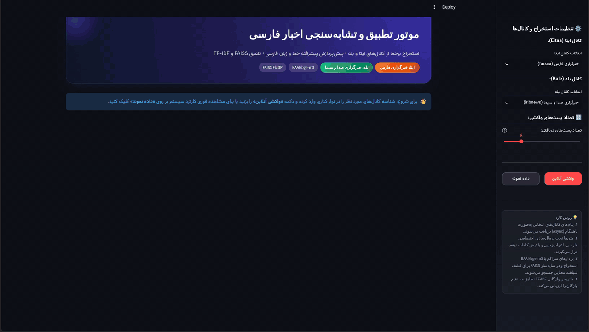
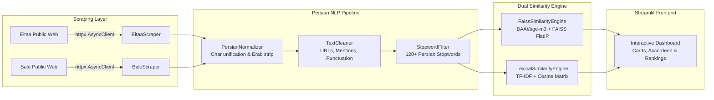

# 📰 Persian News Similarity Engine (Eitaa & Bale)

[](https://www.python.org/)
[](https://streamlit.io/)
[](https://github.com/facebookresearch/faiss)
[](https://huggingface.co/BAAI/bge-m3)
[](https://docs.pydantic.dev/)
[](https://docs.pytest.org/)

A production-grade, asynchronous NLP application that extracts public news posts from two major Iranian messaging platforms (**Eitaa** and **Bale**), applies specialized Persian preprocessing, and computes both **Dense Semantic Similarity** (using `BAAI/bge-m3` + FAISS Vector Search) and **Lexical Similarity** (using TF-IDF + Cosine Similarity). The platform features an interactive, RTL-optimized **Streamlit** user interface.

<p align="center">
  
</p>

---

## 📌 Architecture Overview



---

## 🌟 Key Features

### 1. Zero-Overhead Asynchronous Scraping
* **No Selenium/Playwright Overhead**: Directly scrapes public web views via lightweight asynchronous HTTP requests:
  * **Eitaa**: `https://eitaa.com/{channel_id}` (extracts clean text from `div.eitaa_message_text`).
  * **Bale**: `https://ble.ir/{channel_id}` (extracts messages with robust fallback container selectors).
* **Resilience**: Full retry logic, custom browser headers, timeout controls, and graceful handling of `404 Not Found` or `429 Rate Limits`.

### 2. Specialized Persian NLP Preprocessing Pipeline
* **Character Normalization**: Unifies Arabic discrepancies (`ي` $\to$ `ی`, `ك` $\to$ `ک`, `ة` $\to$ `ه`), cleans Tashdeed, Tanwin, and diacritics via Unicode `Mn` decomposition, and standardizes Zero-Width Non-Joiners (ZWNJ / نیم‌فاصله `\u200c`).
* **Noise Cleaning**: Strips URLs, `@channel` mentions, emails, emojis, English/Persian/Arabic digits, and typography marks (`،`, `؛`, `؟`, `«`, `»`, `.`, `!`).
* **Self-Contained Stopword Filter**: Eliminates 120+ high-frequency Persian stopwords and single-character stray tokens without relying on external runtime downloads.

### 3. Dual Similarity Mechanism
* **Dense Semantic Similarity (Deep Representation)**:
  * Vectorizes text using `BAAI/bge-m3` dense embeddings ($L_2$ normalized).
  * Fast vector indexing and similarity query with `faiss.IndexFlatIP`.
  * Maps raw inner product $[-1.0, 1.0]$ to a normalized $[0\%, 100\%]$ percentage scale.
* **Lexical Similarity (Surface Representation)**:
  * Tokenizes with ZWNJ-aware regular expressions.
  * Computes TF-IDF vector representations and exact pairwise Cosine Similarity with zero-division error handling.

### 4. Interactive Streamlit UI
* **Full RTL Support**: Tailored with the Persian **Vazirmatn** typography.
* **Color-Coded Similarity Score Cards**:
  * 🟢 **High ($\ge 75\%$)**: Strong semantic and topical alignment.
  * 🟡 **Moderate ($50\% - 74\%$)**: Partial conceptual overlap.
  * 🔴 **Low ($< 50\%$)**: Divergent news stories.
* **Side-by-Side News Inspection**: Compare raw texts alongside word/character metrics.
* **Step-by-Step NLP Breakdown**: Expandable inspector revealing intermediate transformations at each pipeline stage.
* **Automatic Best-Match Discovery**: Queries FAISS to rank all retrieved Bale posts against the selected Eitaa post.
* **Offline Demo Mode**: Immediate evaluation using built-in news sample datasets without network dependence.

---

## 📂 Project Directory Structure

```text
news-similarity-engine/
│
├── .env                        # Active environment configuration
├── .env.example                # Configuration template
├── config.py                   # Pydantic Settings schema & validated constants
├── requirements.txt            # Python dependencies with pinned versions
├── app.py                      # Main Streamlit application entry point
│
├── src/
│   ├── __init__.py
│   │
│   ├── scrapers/               # Asynchronous web extraction layer
│   │   ├── __init__.py
│   │   ├── base.py             # BaseScraper with httpx client & custom headers
│   │   ├── eitaa.py            # Eitaa channel parser (div.eitaa_message_text)
│   │   └── bale.py             # Bale channel parser with fallback selectors
│   │
│   ├── nlp/                    # Persian NLP preprocessing suite
│   │   ├── __init__.py         # PersianNLPPipeline orchestrator
│   │   ├── normalizer.py       # Arabic/Persian normalizer & ZWNJ standardizer
│   │   ├── cleaner.py          # URLs, mentions, emojis, and punctuation cleaner
│   │   └── stopwords.py        # 120+ Persian stopwords filter
│   │
│   ├── similarity/             # Vector indexing and computational engines
│   │   ├── __init__.py
│   │   ├── faiss_engine.py     # BAAI/bge-m3 dense embedder + FAISS IndexFlatIP
│   │   └── lexical_engine.py   # TF-IDF vectorizer + Cosine Similarity
│   │
│   └── ui/                     # Presentation and styling components
│       ├── __init__.py
│       ├── styles.py           # Custom CSS, Vazirmatn font, and RTL theme
│       └── components.py       # Metrics cards, comparison views, and ranking tables
│
└── tests/
    ├── __init__.py
    ├── test_nlp.py             # Unit tests for normalizer, cleaner, and stopwords
    ├── test_scrapers.py        # Unit tests with mock HTML fixtures for Eitaa & Bale
    └── test_similarity.py      # Unit tests for TF-IDF & FAISS cosine mappings
```

---

## ⚙️ Configuration (.env & Pydantic Settings)

All application settings are managed with **Pydantic v2 Settings** and can be customized via the `.env` file:

| Parameter | Type | Default | Description |
| :--- | :--- | :--- | :--- |
| `EMBEDDING_MODEL_NAME` | `str` | `BAAI/bge-m3` | Hugging Face model identifier for sentence embeddings |
| `SIMILARITY_HIGH_THRESHOLD` | `float` | `0.75` | Minimum score for High similarity classification |
| `SIMILARITY_MODERATE_THRESHOLD` | `float` | `0.50` | Threshold score for Moderate similarity classification |
| `USER_AGENT` | `str` | *Chrome 124 User-Agent* | Standard browser user-agent header |
| `REQUEST_TIMEOUT` | `float` | `12.0` | HTTP request timeout in seconds |
| `MIN_POST_LENGTH` | `int` | `35` | Minimum characters to filter out media captions or empty posts |
| `DEFAULT_EITAA_CHANNEL` | `str` | `farsna` | Default Eitaa channel identifier |
| `DEFAULT_BALE_CHANNEL` | `str` | `iribnews` | Default Bale channel identifier |

---

## 🚀 Quickstart Guide

### 1. Clone & Set Up Virtual Environment

```bash
cd news-similarity-engine

# Create virtual environment
python3 -m venv .venv
source .venv/bin/activate
```

### 2. Install Dependencies

```bash
pip install -r requirements.txt
```

### 3. Environment Configuration

```bash
# Copy template to .env (customize if needed)
cp .env.example .env
```

### 4. Run Unit Tests

Verify the entire pipeline using `pytest`:

```bash
pytest tests/ -v
```

Output:
```text
tests/test_nlp.py ................ PASSED
tests/test_scrapers.py ......     PASSED
tests/test_similarity.py .....    PASSED
======================== 27 passed in 9.65s ========================
```

### 5. Launch Streamlit Application

```bash
streamlit run app.py
```

The web dashboard will be available at: **`http://localhost:8501`**

---

## 🧪 NLP Pipeline Example

| Stage | Input / Output Sample |
| :--- | :--- |
| **Raw Text** | `خبر فوری: بانك مركزي در https://cbi.ir اعلام كرد سود ۳۰٪ ابلاغ شد! 🚀 @cbi` |
| **1. Normalized** | `خبر فوری: بانک مرکزی در https://cbi.ir اعلام کرد سود ۳۰٪ ابلاغ شد! 🚀 @cbi` *(Arabic ك $\to$ ک, ي $\to$ ی)* |
| **2. Cleaned** | `خبر فوری بانک مرکزی در اعلام کرد سود ابلاغ شد` *(URLs, @mentions, digits, emojis, punctuation stripped)* |
| **3. Stopwords Filtered** | `خبر فوری بانک مرکزی اعلام سود ابلاغ` *(در, کرد, شد removed)* |

---

## 📊 Similarity Metrics Explained

* **Semantic Similarity ($S_{\text{dense}}$)**:
  $$\cos(\mathbf{u}, \mathbf{v}) = \frac{\mathbf{u} \cdot \mathbf{v}}{\|\mathbf{u}\|_2 \|\mathbf{v}\|_2}$$
  Mapped to $[0, 1]$ percentage score:
  $$\text{Score} = \text{clip}\left(\frac{\cos(\mathbf{u}, \mathbf{v}) + 1.0}{2.0}, 0.0, 1.0\right)$$
* **Lexical Similarity ($S_{\text{lex}}$)**:
  $$\text{Score} = \frac{\mathbf{x}_{\text{tfidf}} \cdot \mathbf{y}_{\text{tfidf}}}{\|\mathbf{x}_{\text{tfidf}}\|_2 \|\mathbf{y}_{\text{tfidf}}\|_2}$$

---

## 🛡️ License

This project is licensed under the [MIT License](file:///home/amin/projects/Data-Minning-Projects/LICENSE).
